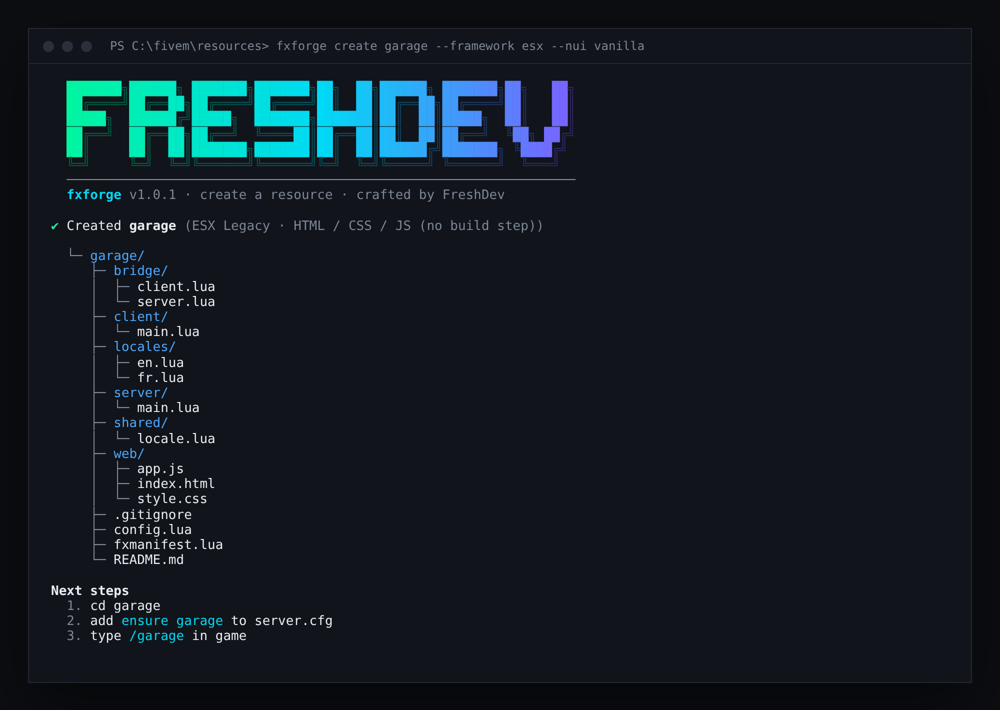

<div align="center">

# ▲ fxforge

**Scaffold, lint and package FiveM resources from your terminal.**

[](https://www.npmjs.com/package/fxforge)
[](https://github.com/FreshlapeufDev/fxforge/actions/workflows/ci.yml)
[](https://nodejs.org)
[](https://github.com/FreshlapeufDev/fxforge/blob/main/LICENSE)

Zero dependencies · ESX · QBCore · Qbox · Standalone

**English** · [Français](https://github.com/FreshlapeufDev/fxforge/blob/main/README.fr.md)

</div>

<p align="center"></p>

## Why

Every FiveM resource starts the same way: copy an old folder, rename the events, fix the manifest, forget a file in `files {}`, and discover in game that the UI is blank. Then it works on your Windows dev server and breaks on the Linux production box because of one capital letter.

fxforge does the boring part for you and catches those mistakes **before** you `ensure`.

## Requirements

- [Node.js](https://nodejs.org) 18 or newer (pick the **LTS** version). npm comes with it.
- Works on Windows, Linux and macOS.

## Install

```bash
npm install -g fxforge
```

or run it once without installing anything:

```bash
npx fxforge create my_resource
```

## Commands

| Command | What it does |
|---|---|
| [`fxforge create [name]`](#fxforge-create-name) | generate a ready-to-run resource |
| [`fxforge check [dir]`](#fxforge-check-dir) | lint `fxmanifest.lua` against the files on disk |
| [`fxforge pack [dir]`](#fxforge-pack-dir) | build a clean release `.zip` |
| [`fxforge add <kind> [name]`](#fxforge-add-kind-name) | add a script, a locale or a NUI to a resource |

Every command starts with the FreshDev logo. Add `--no-banner` to hide it, for example in scripts or CI logs.

### `fxforge create [name]`

Generates a resource that runs as soon as you `ensure` it. Without flags, it asks you a few questions.

| Flag | Values | Default |
|---|---|---|
| `--framework` | `standalone` `esx` `qbcore` `qbox` | `standalone` |
| `--nui` | `none` `vanilla` `vite` | `none` |
| `--locale` | `en` `fr` | `en` |
| `--description` | text | `A FiveM resource` |
| `--author` | text | your git user name |
| `--dir` | parent folder | current folder |
| `--no-git` `--force` `-y` | | |

What you get:

- a clean `fxmanifest.lua` with `lua54`, metadata and the right dependencies
- a **bridge layer** (`Bridge.Notify`, `Bridge.GetIdentifier`) written for the chosen framework, so your game logic does not depend on it
- a small locale system (`Lang('key', ...)`) with English and French
- a working command → server event round trip to build on
- optionally a NUI, either plain HTML/CSS/JS or **Vite + TypeScript** built into `web/dist`

### `fxforge check [dir]`

Reads `fxmanifest.lua` with a real tokenizer (comments and long strings included) and checks it against the files on disk.

```
$ fxforge check

  ✖ client_script 'client/Main.lua' only exists as 'client/main.lua' [case-mismatch] fxmanifest.lua:8
    ↳ Works on Windows, breaks on Linux servers
  ✖ Server script 'server/main.lua' is also listed in files [server-file-exposed]
    ↳ Every client downloads it: never ship server code or secrets
  ▲ '@ox_lib/…' is used but 'ox_lib' is not in dependencies [undeclared-dependency] fxmanifest.lua:7
    ↳ The resource may start before it and crash

  2 errors · 1 warning · 0 info
```

| Code | Level | What it catches |
|---|---|---|
| `case-mismatch` | error | `Client/Main.lua` vs `client/main.lua`: fine on Windows, broken on Linux |
| `missing-file` | error | a referenced file that does not exist (with a hint for unbuilt UIs) |
| `server-file-exposed` | error | a server script also listed in `files`, so **every player downloads it** |
| `ui-page-not-shipped` | error | `ui_page` missing from `files`: blank screen in game |
| `nui-asset-not-shipped` | error | CSS or JS loaded by your HTML but not shipped: 404 in game |
| `unknown-fx-version` / `missing-game` | error | invalid manifest header |
| `legacy-manifest` | error | old `__resource.lua` |
| `undeclared-dependency` | warn | `@ox_lib/init.lua` used without `dependency 'ox_lib'` |
| `client-server-overlap` | warn | the same file loaded on both sides instead of `shared_scripts` |
| `empty-glob` | warn | a pattern like `client/*.lua` that matches nothing |
| `data-file-not-shipped` | warn | a `data_file` whose file is not in `files` |
| `lua54-missing` | warn | Lua 5.4 not enabled |
| `outdated-fx-version` | warn | `bodacious` or `adamant` |
| `duplicate-entry` | warn | the same entry listed twice |
| `resource-name` | warn | uppercase letters or spaces in the folder name |
| `unreferenced-lua` | info | a Lua file that is never loaded |
| `missing-metadata` | info | no version, author or description |

Add `--json` for tooling and `--strict` to fail on warnings too. The exit code is `1` when errors are found, so it fits straight into CI:

```yaml
- run: npx fxforge check --strict
```

### `fxforge pack [dir]`

Builds `dist/<name>-<version>.zip` with **only the files the manifest actually loads**, plus `stream/`, README and LICENSE. Notes, source maps, `web/src`, `node_modules` and other dev files stay out. It refuses to pack a resource with errors unless you pass `--force`.

```
$ fxforge pack

  ✔ dist/garage-1.0.0.zip
    13 files · 6.8 KB → 4.9 KB
    1 file left out (not used by the manifest)
```

| Flag | |
|---|---|
| `--out <dir>` | output folder |
| `--include <globs>` | extra files, comma-separated |
| `--all` | ship everything except dev-only files |
| `--verbose` | list the files that were left out |

### `fxforge add <kind> [name]`

```bash
fxforge add client garage     # client/garage.lua
fxforge add server billing    # server/billing.lua
fxforge add shared utils      # shared/utils.lua
fxforge add locale de         # locales/de.lua, copied from en
fxforge add nui               # web/ + ui_page + files
```

The manifest is only edited when the new file is not already covered by a pattern such as `client/*.lua`.

## Generated layout

```
my_resource/
├─ bridge/        framework adapter (client + server)
├─ client/        client scripts
├─ server/        server scripts
├─ shared/        locale helper and shared code
├─ locales/       en.lua, fr.lua
├─ web/           NUI (optional)
├─ config.lua
└─ fxmanifest.lua
```

## Development

```bash
git clone https://github.com/FreshlapeufDev/fxforge
cd fxforge
npm test
npm link
```

`npm link` makes the global `fxforge` command use your local copy.

There is no runtime dependency: the manifest parser, the glob matcher and the zip writer are written from scratch on top of Node's standard library.

What changed in each version: [CHANGELOG.md](https://github.com/FreshlapeufDev/fxforge/blob/main/CHANGELOG.md).

Bug or idea? [Open an issue](https://github.com/FreshlapeufDev/fxforge/issues).

## Related

[**fxguard**](https://github.com/FreshlapeufDev/fxguard) — security scanner for FiveM resources: exploitable net events, SQL injections, backdoors and leaked secrets.

## License

MIT © FreshDev — Fresh&Dev
